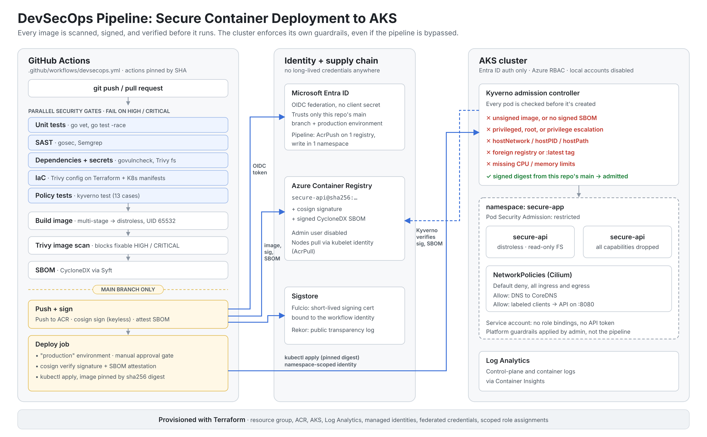
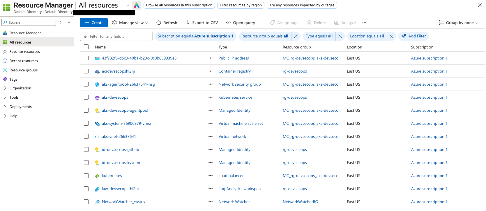
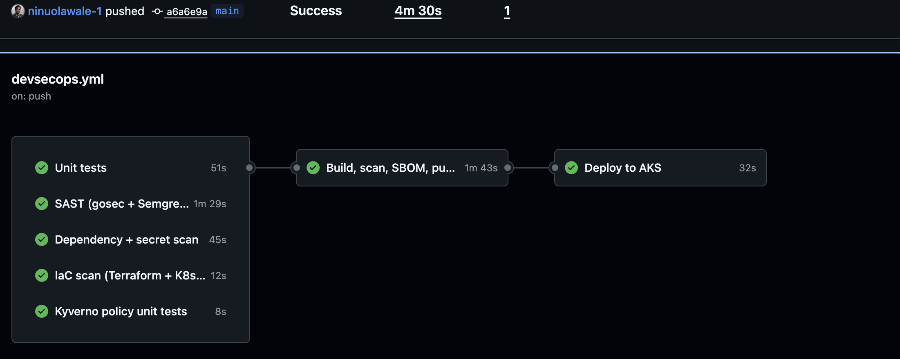
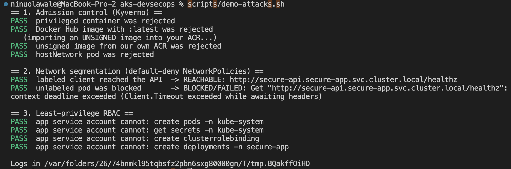
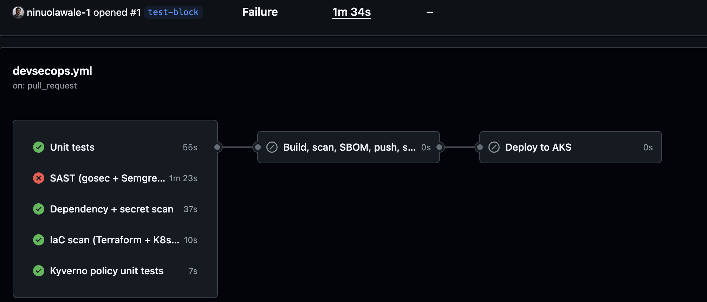
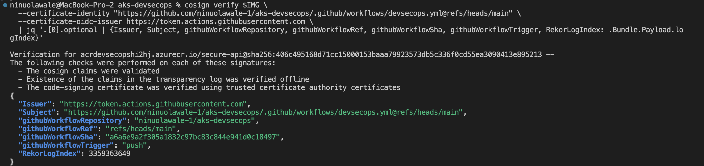

# DevSecOps Pipeline: Secure Container Deployment to AKS



## Platforms and Languages Leveraged
- Microsoft Azure (AKS, Azure Container Registry, Log Analytics, Managed Identities, Entra ID)
- Terraform (HashiCorp Configuration Language), AzureRM Provider 4.x
- GitHub Actions (OIDC federation, protected environments)
- Kubernetes (Cilium NetworkPolicies, RBAC, Pod Security Admission, Kustomize)
- Kyverno v1.19 (admission control and policy testing)
- Sigstore cosign (keyless signing and attestations)
- Trivy, gosec, Semgrep, govulncheck, Syft (CycloneDX SBOMs)
- Go 1.27, Docker (distroless images)
- Bash, Azure CLI, Helm, Git

## Scenario

The goal of this project was to build a delivery pipeline where security checks are the path to production, not a separate review step that someone remembers to run. Many container pipelines build an image, push it, and deploy it with almost nothing in between. They don't block vulnerable dependencies, they can't prove where an image came from, and the cluster will run whatever it's handed, including root containers, privileged pods, and images pulled straight from Docker Hub.

This pipeline fails the build on high or critical findings at every stage, signs each image it ships, and records a software bill of materials. The AKS cluster then enforces its own rules at admission time, so it rejects unsigned or unsafe workloads even if someone bypasses the pipeline entirely. All of the infrastructure is defined in Terraform, and no long-lived credentials exist anywhere in the setup.

### High-Level Build Plan

- **Provision** AKS, ACR, Log Analytics, and scoped managed identities in Terraform, with local cluster accounts disabled.
- **Gate** every change on SAST, dependency, secret, IaC, and container image scans that fail on high or critical findings.
- **Harden** the container image with a multi-stage build on a distroless, non-root base.
- **Secure** the supply chain by signing each image with cosign and attesting a CycloneDX SBOM, then deploying by digest.
- **Enforce** cluster guardrails with Kyverno admission policies, default-deny NetworkPolicies, and least-privilege RBAC.
- **Validate** each control by attempting the exact attacks it's meant to stop.

---

## Steps Taken

### 1. Provisioned the Platform in Terraform

Defined a resource group, an ACR (admin user disabled), a Log Analytics workspace, and an AKS cluster using the Cilium network dataplane in East US. The cluster has local accounts turned off, so there's no static admin kubeconfig to leak; every person and pipeline authenticates through Entra ID, and authorization is handled by Azure RBAC. The first deployment ran into a VM SKU restriction and then a vCPU quota limit in East US. Moving the node pool to `Standard_D2as_v4` resolved both, and the change was a one-line variable override rather than an edit to the module.

```hcl
  local_account_disabled            = true
  role_based_access_control_enabled = true

  azure_active_directory_role_based_access_control {
    azure_rbac_enabled = true
    tenant_id          = data.azurerm_client_config.current.tenant_id
  }
```

**Deployed resources in Azure.** Terraform created everything in `rg-devsecops`. AKS creates and manages the second resource group (`MC_rg-devsecops_...`), which holds the node scale set, virtual network, NSG, and load balancer.



### 2. Replaced Stored Credentials With OIDC Federation

GitHub Actions authenticates to Azure with short-lived OIDC tokens instead of a client secret. The managed identity trusts tokens only from this repo's `main` branch and its `production` environment, so a fork, a feature branch, or another repo can't assume it. The identity can push to one registry and write to one namespace, and nothing else.

```hcl
  subject = "repo:${var.github_owner}/${var.github_repo}:environment:production"
```

```hcl
resource "azurerm_role_assignment" "github_ns_writer" {
  scope                = "${azurerm_kubernetes_cluster.aks.id}/namespaces/${var.app_namespace}"
  role_definition_name = "Azure Kubernetes Service RBAC Writer"
  principal_id         = azurerm_user_assigned_identity.github.principal_id
}
```

### 3. Built the Scanning Gates

The pipeline runs five jobs in parallel on every push and pull request: unit tests, SAST (gosec and Semgrep), dependency and secret scanning (govulncheck and Trivy), IaC scanning of Terraform and Kubernetes manifests (Trivy config), and Kyverno policy unit tests. The build only starts if all five pass. Every third-party action is pinned to a full commit SHA, because a tag can be moved by whoever controls the action's repo and a SHA can't.

While testing, I found that gosec run from the repo root scanned **zero files** and still reported success, because the Go module lives in `app/`. After the scan was moved into the module directory, it flagged a real high-severity finding. A security gate that passes without checking anything is worse than having no gate, since it creates false confidence.

### 4. Hardened the Container Image

The Dockerfile compiles a static binary in a full Go image, then copies only that binary onto `distroless/static` running as UID 65532. The final image has no shell, no package manager, and no libc. A separate `Dockerfile.baseline` reproduces the common starting point (a full OS image running as root), so both images can be scanned side by side.

```dockerfile
FROM gcr.io/distroless/static-debian12:nonroot
COPY --from=build /out/secure-api /secure-api
USER 65532:65532
ENTRYPOINT ["/secure-api"]
```

The app itself sets explicit HTTP timeouts and security headers. It also includes a `probe` mode, so NetworkPolicy tests can run from the same signed image instead of an unsigned debug container.

### 5. Signed the Image and Attested the SBOM

After the image passes Trivy (blocking on fixable high and critical CVEs), Syft generates a CycloneDX SBOM. The image is pushed to ACR, and cosign signs its **digest** keylessly through Sigstore. The signature is bound to the workflow's GitHub identity and recorded in the Rekor transparency log, so there's no signing key to store, rotate, or leak. The SBOM is attached as a signed attestation.

```bash
cosign sign --yes "$IMAGE"
cosign attest --yes --type cyclonedx --predicate sbom.cdx.json "$IMAGE"
```

Cosign is pinned to v2.6.1 on purpose. Cosign v3 stores signatures as OCI 1.1 referrers by default, which Kyverno's `ClusterPolicy` image verification doesn't read, so the signer and verifier have to stay on the same format.

### 6. Enforced Admission Policies With Kyverno

Kyverno runs as an admission controller and rejects any pod that:

- uses an image from our ACR without a valid signature from this repo's `main` workflow, or without a signed SBOM attestation
- runs privileged, allows privilege escalation, or doesn't run as non-root
- uses `hostNetwork`, `hostPID`, `hostIPC`, or `hostPath` volumes
- doesn't drop all Linux capabilities
- pulls from any registry other than the project ACR, or uses `:latest`
- doesn't set CPU and memory requests and limits

Kyverno reads signatures from the private ACR through its own pull-only managed identity (AKS Workload Identity), so no registry password lives in the cluster. The namespace also enforces Pod Security Admission `restricted` as a second, built-in layer under Kyverno.

The policies have their own test suite of 13 cases: a compliant Deployment plus one Deployment that breaks each rule. CI runs it on every change, so a broken policy fails the pipeline before it ever reaches the cluster.

### 7. Segmented the Network and Scoped RBAC

The application namespace starts with a default-deny NetworkPolicy for all ingress and egress. Explicit policies then allow DNS to CoreDNS and allow port 8080 traffic only from pods labeled as approved clients. The app runs under a dedicated service account with no role bindings and no mounted API token. A read-only auditor Role, with no access to Secrets, can be bound to an Entra ID group.

```yaml
spec:
  podSelector: {}
  policyTypes:
    - Ingress
    - Egress
```

Platform guardrails (the namespace, NetworkPolicies, RBAC, and Kyverno) are applied by the cluster admin. The pipeline can only deploy the app, so a compromised pipeline can't switch the guardrails off.

### 8. Deployed With a Manual Approval Gate

The deploy job runs in a protected GitHub `production` environment that requires reviewer approval. Before applying anything, it verifies the image's signature and SBOM attestation, then pins the Deployment to the exact digest that was scanned and signed.

### 9. Validated the Controls

Each control was tested by attempting the thing it's supposed to prevent, not just by confirming that the happy path works.

**Pipeline run with all gates passing**



**Admission and network attack tests (`scripts/demo-attacks.sh`)**



**Pipeline blocking a vulnerable change**



**Signature verification against the running image**



---

## Security Controls

| Control | Before | After | Validation |
|---|---|---|---|
| Code and dependencies | No scanning | SAST, dependency, and secret scans block on high/critical | Seeded findings fail the build |
| Infrastructure as code | Unreviewed | Trivy config scan on Terraform and manifests; exceptions need a reason and an expiry date | Privileged manifest fails the build |
| Base image | Full OS image running as root | Distroless, non-root, static binary | Trivy before/after comparison |
| Image provenance | Anything in the registry can run | Keyless cosign signature + signed SBOM, verified in CI and at admission | Unsigned image in our own ACR is rejected |
| Workload security | Privileged and root pods allowed | Kyverno + PSA `restricted` | Privileged and hostNetwork pods rejected |
| Network | Flat; every pod reaches every pod | Default-deny with explicit allows | Unlabeled pod can't reach the API |
| Pipeline credentials | Stored client secret | OIDC federation scoped to `main` and `production` | No secrets in the repo or GitHub settings |
| Cluster access | Static admin kubeconfig | Entra ID only, Azure RBAC, namespace-scoped pipeline | App service account denied all API actions |

---

## Timeline of Build Events

1. **Platform Provisioned**: AKS, ACR, Log Analytics, and managed identities deployed with Terraform. SKU and quota limits resolved by moving to `Standard_D2as_v4`.
2. **OIDC Configured**: GitHub federated to Azure with no stored secrets, scoped to `main` and the `production` environment.
3. **Scanning Gates Built**: SAST, dependency, secret, IaC, and image scans wired in to block on high/critical findings. A gosec job that silently scanned zero files was found and fixed.
4. **Image Hardened**: Multi-stage distroless build running as non-root.
5. **Supply Chain Secured**: Images signed keylessly with cosign and attested with CycloneDX SBOMs, then deployed by digest.
6. **Admission Control Enforced**: Kyverno installed with Workload Identity; signature, hardening, and image policies enforced and unit-tested.
7. **Network and RBAC Locked Down**: Default-deny NetworkPolicies, PSA `restricted`, and a token-less app service account applied.
8. **Controls Validated**: Attack demo run against the live cluster; vulnerable changes confirmed to fail the pipeline.

---

## Usage

```bash
# 1. Provision Azure
az login
cd infra/terraform
cp terraform.tfvars.example terraform.tfvars   # fill in subscription and GitHub owner/repo
terraform init && terraform apply
cd ../..

# 2. Add AZURE_CLIENT_ID, AZURE_TENANT_ID, AZURE_SUBSCRIPTION_ID, ACR_NAME,
#    AKS_NAME, AKS_RESOURCE_GROUP as GitHub Actions variables, and create a
#    "production" environment with a required reviewer.

# 3. Install Kyverno, policies, and platform guardrails
scripts/bootstrap-cluster.sh <github-owner> aks-devsecops

# 4. Push to main and approve the deploy in the Actions tab

# 5. Prove the controls, then tear down
scripts/demo-attacks.sh
scripts/teardown.sh
```

**Requirements:** an Azure subscription with Owner rights (Terraform creates role assignments), Azure CLI, Terraform 1.6+, kubectl, kubelogin, and Helm 3. Docker and Trivy are needed only for `scripts/compare-cves.sh`.

---

## Summary

This project builds a container delivery pipeline where every image is scanned, signed, and verified before it runs, and where the cluster enforces its own security baseline instead of trusting the pipeline. Code, dependencies, infrastructure, and images are each scanned and gated on high or critical findings. Images are hardened, signed keylessly, and shipped with a signed SBOM, and the AKS cluster rejects anything unsigned, privileged, or from an untrusted source. Credentials are short-lived throughout, and each control was validated by attempting the attack it's meant to stop.

---

## Lessons Learned

- **A gate that never fails proves nothing.** gosec reported success while scanning zero files. Every security check needs a known-bad input that shows it actually blocks something.
- **Enforce in two places.** Pipeline checks catch problems early, but only admission control catches a workload that skips the pipeline, such as a direct `kubectl apply` or a stolen token.
- **Deploy digests, not tags.** A tag can be repointed after a scan. A digest guarantees the cluster runs the exact bytes that were scanned and signed.
- **Tooling versions are part of the security design.** Cosign v3 changed its default signature format, which would have broken Kyverno verification without any error at signing time.
- **Cloud capacity is a real constraint.** The cluster first failed on a SKU restriction and then on a vCPU quota limit. Checking regional quota before `terraform apply` saves a failed run.

---

## Next Steps

- Migrate the Kyverno `ClusterPolicy` resources to CEL-based `ValidatingPolicy` and `ImageValidatingPolicy`, which allows upgrading to cosign v3.
- Make the cluster private and run deployments from a self-hosted runner inside the VNet, closing the documented public API exception.
- Add Microsoft Defender for Containers for runtime threat detection, since Kyverno only covers admission time.
- Pin base images by digest and let Dependabot keep action SHAs and image digests current.
- Move Terraform state to an Azure Storage remote backend with locking.